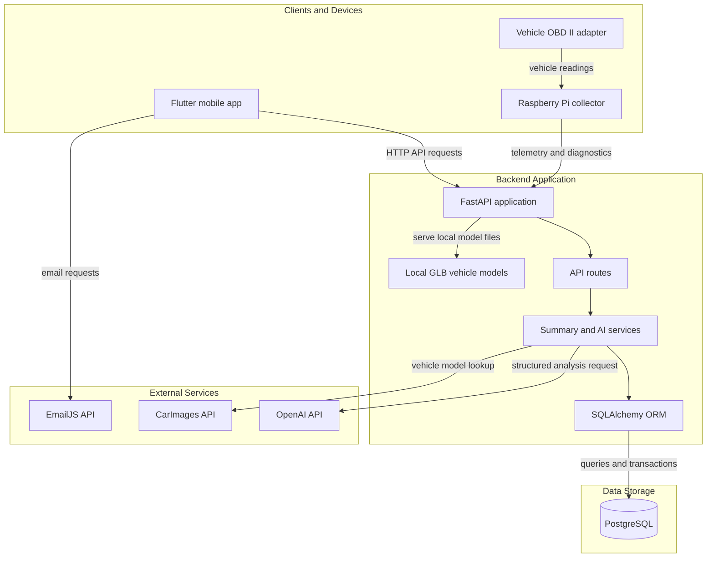
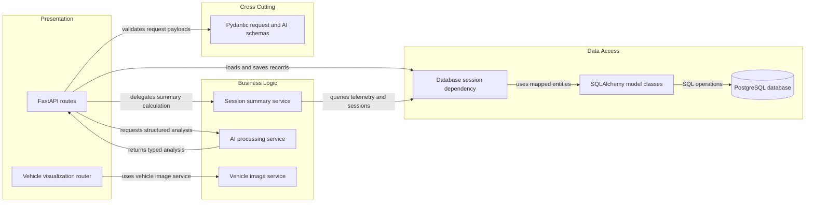

# Architecture Diagram

This project combines a Flutter mobile client and a Raspberry Pi OBD-II collector with a Python FastAPI backend. The backend persists vehicle data and structured AI health assessments in PostgreSQL and integrates with external AI and vehicle-model services.

## Application Architecture

<!-- mermaid-checked: no \n, no em-dash/en-dash, no {} in labels, subgraphs are id["label"], arrows are -->|"label"|, all subgraphs closed by end, ids unique -->

### Technology Stack Summary

| Layer | Technology | Version | Purpose |
|---|---|---|---|
| Client | Flutter and Dart | Dart SDK constraint `^3.11.4` | Mobile UI and HTTP API client |
| Device | Python, `obd`, and `requests` | Not pinned in the device project files | Read OBD-II data and send it to the backend |
| API | FastAPI and Pydantic | FastAPI `0.136.3`; Pydantic `2.13.4` | HTTP endpoints and request/response validation |
| Data access | SQLAlchemy and psycopg2 | SQLAlchemy `2.0.50`; psycopg2-binary `2.9.12` | ORM mappings and PostgreSQL connectivity |
| Database | PostgreSQL | Server version not specified | Persistent application records |
| AI integration | OpenAI Python SDK | `3.37.0` | Structured diagnostic and vehicle analysis |
| Vehicle models | CarImages API and local GLB files | External API version path `v1` | Resolve and serve 3D vehicle models |
| Email | EmailJS HTTP API | Not specified | Email requests initiated by the mobile app |

### Data Storage & External Services

The backend uses PostgreSQL through SQLAlchemy, with a connection URL supplied through environment configuration. Structured AI health results are stored across assessment, system-assessment, and finding tables; session summaries and diagnostic code causes/evidence use JSON or JSONB columns. The backend calls OpenAI for structured analysis and CarImages for vehicle model data. The mobile app also contains an EmailJS integration. Local GLB assets are served by the backend. No cache or message broker was identified.

### Key Architectural Decisions

- The backend centralizes persistence and exposes HTTP endpoints to both the Flutter app and Raspberry Pi collector.
- SQLAlchemy model classes define the persistence schema; request/analysis payloads are separately validated with Pydantic.
- AI output is persisted as related structured records rather than one opaque response blob.

## Component Relationships

<!-- mermaid-checked: no \n, no em-dash/en-dash, no {} in labels, subgraphs are id["label"], arrows are -->|"label"|, all subgraphs closed by end, ids unique -->

### Component Inventory

| Component | Layer | Type | Responsibility |
|---|---|---|---|
| FastAPI routes | Presentation | API application | Handles account, vehicle, telemetry, trip, diagnostics, maintenance, chat, summary, and analysis requests |
| Vehicle visualization router | Presentation | APIRouter | Returns vehicle visualization metadata and serves 3D model files |
| Session summary service | Business Logic | Service module | Queries session telemetry and calculates summary and quality metrics |
| AI processing service | Business Logic | Service module | Calls OpenAI and validates structured analysis results |
| Vehicle image service | Business Logic | Service module | Retrieves vehicle generations and 3D model files from CarImages |
| SQLAlchemy model classes | Data Access | ORM entities | Map application records and foreign-key relationships |
| Database session dependency | Data Access | SQLAlchemy session factory | Provides request-scoped database sessions |
| PostgreSQL database | Data Access | Relational database | Stores users, vehicles, trips, telemetry, diagnostics, maintenance, summaries, and assessments |
| Pydantic request and AI schemas | Cross Cutting | Validation models | Validates API input and typed AI output |
